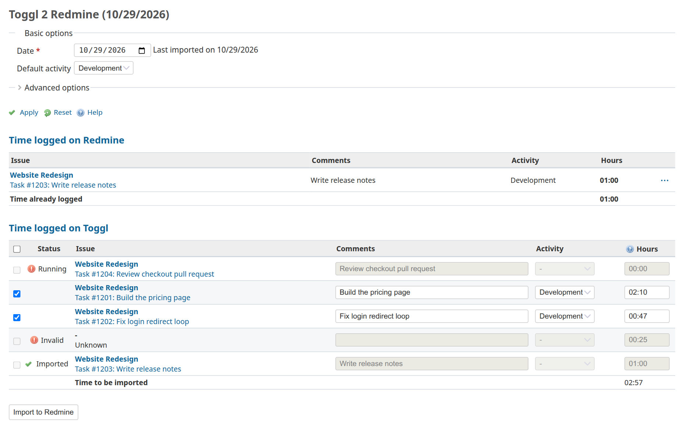
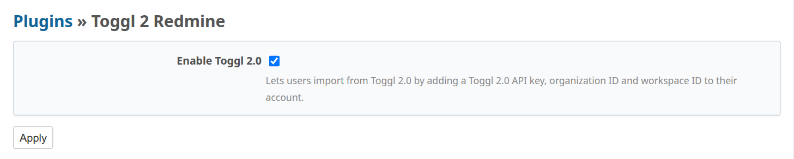
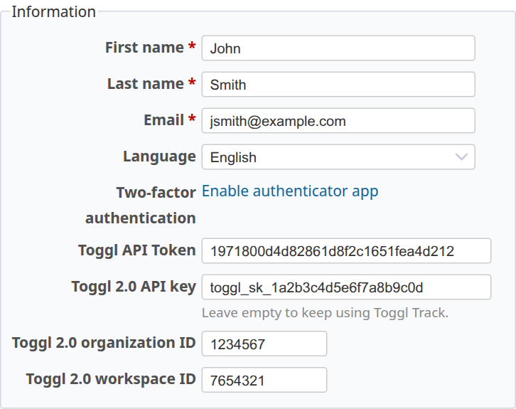

# Toggl 2 Redmine


A Redmine plugin that imports your time entries from Toggl into Redmine. It
works with Toggl Track and with Toggl 2.0.

Toggl entries for the same issue and description are grouped into a single
Redmine time entry. You can start and stop your timer as often as you like
during the day and still end up with one clean entry per task in Redmine.



This is a maintained fork of [jigarius/toggl2redmine](https://github.com/jigarius/toggl2redmine),
updated for Redmine 6 and 7, the Toggl Track API v9 and Toggl 2.0.

## Compatibility

| Plugin  | Redmine  | Toggl                              |
|---------|----------|------------------------------------|
| 7.x     | 7.0+     | Toggl Track (API v9) and Toggl 2.0 |
| 6.x     | 6.0, 6.1 | Toggl Track (API v9) and Toggl 2.0 |
| 5.x     | 5.x      | Toggl Track (API v8, retired)      |

Toggl has shut down the v8 API, so versions before 6.1.0 can no longer load
time entries from Toggl.

## Installation

* Clone the plugin into the `plugins` directory of Redmine. The directory
  must be named `toggl2redmine`. Pick the latest tag from the
  [releases page](https://github.com/burak-ikiler/toggl2redmine/releases):
  a 6.x tag for Redmine 6, a 7.x tag for Redmine 7.
  ```bash
  cd /path/to/redmine/plugins
  git clone --branch 6.2.1 https://github.com/burak-ikiler/toggl2redmine.git toggl2redmine
  ```
* Run the plugin migrations and restart Redmine.
  ```bash
  cd /path/to/redmine
  RAILS_ENV=production bundle exec rake redmine:plugins:migrate
  ```
  * This adds a _Toggl API Token_ field to every user's account.
* Your database **must** support [transactions](https://en.wikipedia.org/wiki/Database_transaction).
  Without them, users might end up importing duplicate time entries.

To upgrade, check out the new tag, run the migrations again and restart Redmine.

```bash
cd /path/to/redmine/plugins/toggl2redmine
git fetch --tags
git checkout 6.2.1
```

## Setup

### Toggl Track

* Copy your API token from your [Toggl Track profile](https://track.toggl.com/profile).
* On Redmine, open _My account_ (`/my/account`), paste it into
  _Toggl API Token_ and save.
* Make sure your time zone is the same on Toggl and Redmine, so entries show
  up on the right day.
  * Check with your Redmine administrator first. Some teams run Redmine
    without time zones on purpose.

### Toggl 2.0

Toggl 2.0 has its own API, so it is turned off by default.

An administrator turns it on under _Administration » Plugins » Toggl 2 Redmine » Configure_.



Each user who wants to use Toggl 2.0 then fills in these fields on
_My account_:

* _Toggl 2.0 API key_: create one in your Toggl 2.0 settings. It starts with
  `toggl_sk_` and is only shown once. Creating a new key revokes the old one.
* _Toggl 2.0 organization ID_ and _Toggl 2.0 workspace ID_: open the calendar
  in Toggl 2.0 and look at the address bar. The first number is the
  organization ID and the second one is the workspace ID:
  ```
  https://focus.toggl.com/1234567/workspaces/7654321/calendar
                          ^^^^^^^            ^^^^^^^
                          organization ID    workspace ID
  ```



Leave the Toggl 2.0 API key empty to keep using Toggl Track. Nobody is
switched over until they add their own key.

A few things work differently with Toggl 2.0:

* Only entries from the one workspace in your account are loaded.
* Toggl 2.0 has no way to list workspaces, so the workspace option shows the
  workspace ID instead of its name.
* Toggl 2.0 limits API requests per hour depending on your plan. Every refresh
  of the import page uses at least two requests.

## Usage

### Tracking time on Toggl

Start the description of each Toggl entry with the Redmine issue ID:

```
#1919 Feed the bunny wabbit
Bug #1919 Feed the bunny wabbit
```

* `#1919` is the Redmine issue ID. Anything before it is ignored.
* `Feed the bunny wabbit` becomes the comment of the Redmine time entry.
* On Toggl 2.0, if an entry has no description, the name of its task is used
  instead. So a task called `#1919 Feed the bunny wabbit` works too.

### Importing

* Click _Toggl_ in the top menu of Redmine (`/toggl2redmine`).
* _Time logged on Redmine_ lists what you have already logged for the day.
* _Time logged on Toggl_ lists your Toggl entries for the day, grouped by issue
  and comment. Each row has a status:
  * **No status**: ready to import.
  * **Running**: the timer is still running. Stop it on Toggl first.
  * **Invalid**: the issue ID is missing, the issue doesn't exist, you can't
    see it, or its project is closed. Hover over the icon to see why.
  * **Imported**: this entry has already been imported.
* Tick the rows you want to import. You can change the comment, activity and
  hours of each row before importing.
  * Hours can be typed as `1.5` or `1:30`.
  * Press _Up_ or _Down_ in the hours field to round to the nearest 5 minutes,
    or hold _Shift_ to round to the nearest 15 minutes.
* Click _Import to Redmine_. Each row then shows **Imported**, or **Failed**
  with the reason when you hover over the icon.
  * Imports can't be undone from this page, so check the rows first.

### Options

* **Date**: the day to import. Defaults to today.
* **Default activity**: the activity filled in for every row.
* **Toggl workspace** (under _Advanced options_): only show entries from one
  workspace.
* **Duration rounding** (under _Advanced options_): round every entry to a
  number of minutes. With 10 minutes:
  * _Round up_: 1h 26m becomes 1h 30m.
  * _Round down_: 1h 26m becomes 1h 20m.
  * _Round off_: 1h 26m becomes 1h 30m, 1h 24m becomes 1h 20m.
  * _Don't round_ keeps the durations as they are.

Click _Apply_ after changing an option.

## Development

The repository comes with a Docker setup: Redmine 6 on MariaDB, a Node
container for the JavaScript, and Mailhog.

```bash
git clone --branch 6.x https://github.com/burak-ikiler/toggl2redmine.git
cd toggl2redmine
docker compose up -d --build
```

The first start takes a few minutes. When `http://localhost:3000` shows the
Redmine login page, load the sample data:

```bash
docker compose exec redmine rails db:seed
```

You can then log in as `admin` / `admin` or `jsmith` / `jsmith`. Mailhog runs
at `http://localhost:8025` for password resets and other emails.

### Tests

```bash
# Ruby tests (run the two migrate commands once on a fresh database).
docker compose exec -e RAILS_ENV=test redmine rails db:migrate
docker compose exec -e RAILS_ENV=test redmine rails redmine:plugins:migrate
docker compose exec -e RAILS_ENV=test redmine rails redmine:plugins:test NAME=toggl2redmine

# JavaScript lint and tests.
docker compose exec -w /app/assets.src node npm install
docker compose exec -w /app/assets.src node npm run lint
docker compose exec -w /app/assets.src node npm test

# RuboCop, with the same version as CI.
docker run --rm -v "$PWD":/app -w /app ruby:3.3 sh -c 'gem install rubocop -v 1.92.2 && rubocop'
```

### JavaScript

The browser code lives in `assets.src` and is written in TypeScript. It is
bundled into `assets/javascripts/t2r.js`, which is committed, so rebuild it
after changing anything in `assets.src`:

```bash
docker compose exec -w /app/assets.src node npm run compile
```

## Acknowledgements

* [Jigarius](https://jigarius.com/about) created this plugin and maintained
  it up to version 5.
* [Evolving Web](https://evolvingweb.ca/) funded its initial development.

## License

GPL-3.0. See [LICENSE](LICENSE).
